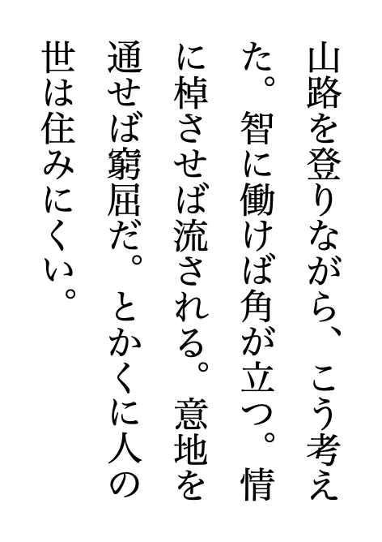

# Tategaki

Vertical Japanese text (縦書き) for SwiftUI.

SwiftUI has no vertical text. `TategakiText` lays text out with Core Text in columns that run top to bottom and
stack right to left, and draws it in a view of exactly the size the columns need. It has no dependencies and uses no
web view.

<p>


</p>

```swift
import SwiftUI
import Tategaki

struct ContentView: View {
    var body: some View {
        TategakiText(
            "山路を登りながら、こう考えた。智に働けば角が立つ。情に棹させば流される。",
            font: .mincho(size: 22),
            maxHeight: 300
        )
    }
}
```

## Installation

In Xcode, choose File › Add Package Dependencies and enter this repository's URL. In `Package.swift`:

```swift
.package(url: "https://github.com/MacchaCat/swift-tategaki", from: "0.1.0")
```

Then add `Tategaki` to your target's dependencies.

Requires macOS 14 or iOS 17.

## Usage

### Height and columns

A `TategakiText` doesn't take its height from the space it's offered. Left alone, the text is one column as long as
it needs to be. Give `maxHeight` and the text continues in a new column to the left when it reaches that height. A
line break in the text also starts a new column.

```swift
TategakiText(text, maxHeight: 240)
```

`columnGap` adds space between columns, on top of the spacing the font asks for. That spacing differs from font to
font: Hiragino's columns are one and a half times the font size apart before any gap.

```swift
TategakiText(text, maxHeight: 240, columnGap: 8)
```

### Fonts

Text is laid out by Core Text, so a font is named the way Core Text names it.

```swift
TategakiText(text, font: .gothic(size: 17))                 // Hiragino Sans, the default
TategakiText(text, font: .mincho(size: 17))                 // Hiragino Mincho
TategakiText(text, font: .named("YuMin-Medium", size: 17))  // any font, by PostScript name
TategakiText(text, font: TategakiFont(myCTFont))            // a CTFont you built
```

A SwiftUI `Font` can't be used, because it can't be turned into a `CTFont`. For the same reason the view doesn't
follow Dynamic Type; scale the size yourself, for example with `@ScaledMetric`.

### Colour

`color` is a SwiftUI `Color`, resolved in the view's environment, so `.primary` and your asset colours follow light
and dark appearance.

### Mixed runs

Runs follow one another in the same column, as words do in a sentence, each in its own font and colour.

```swift
TategakiText(runs: [
    .init("草枕", font: .named("HiraMinProN-W6", size: 34)),
    .init("　夏目漱石\n", font: .mincho(size: 16), color: .secondary),
    .init("智に働けば角が立つ。", font: .mincho(size: 20), color: .red),
], maxHeight: 260)
```

### Accessibility

The view is one accessibility element whose label is its text.

## What it doesn't do yet

Version 0.1 does one thing: set text in vertical columns. It leaves line breaking, punctuation and glyph choice to
Core Text and the font, and these haven't been checked against the rules of Japanese typesetting (JIS X 4051,
JLREQ).

- **Latin letters and digits lie on their side.** There is no tate-chu-yoko (縦中横), which would set short runs of
  them upright within one character's height.
- **No ruby (furigana)**, and no emphasis marks (圏点).
- **No selection or copying**, and no way to find the character at a point.
- **The column pitch can't be set directly**, only adjusted with `columnGap`.
- **The view doesn't size itself to the height it's offered.** You give `maxHeight`.

These are the plan, roughly in that order.

## What has been tested

- Built and tested on macOS 27 with Swift 6.4 (Xcode 27). The tests check column count, column order, bounds and
  that every character is drawn inside the view, and the rendered output was checked by eye.
- Compiled for iOS. It hasn't been run or looked at on an iOS device, and the two built-in faces (`.gothic`,
  `.mincho`) have only been confirmed to be installed on macOS.
- The manifest asks for Swift 6.0 tools, but no toolchain older than 6.4 has been tried.

To render the sample images yourself:

```bash
TATEGAKI_SNAPSHOT_DIR=/tmp/tategaki swift test
```

## 日本語

SwiftUI で日本語を縦書きで表示するためのライブラリです。Core Text で組み、上から下、右から左へ行を並べます。
依存パッケージはなく、WebView も使いません。

現在のバージョンは縦に組むことだけを行います。縦中横、ルビ、圏点、文字の選択にはまだ対応していません。
英数字は横倒しになります。

## License

MIT. See [LICENSE](LICENSE).
