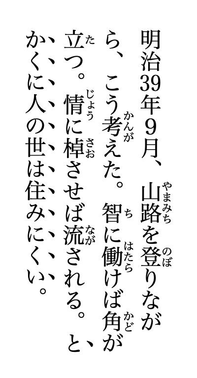
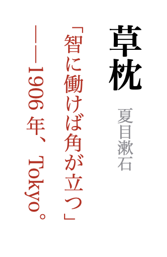
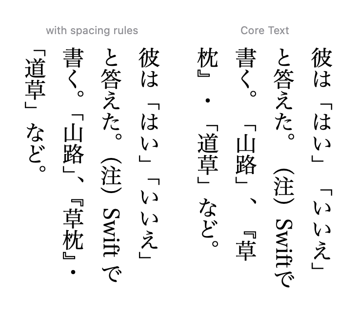

# Tategaki

Vertical Japanese text (縦書き) for SwiftUI, with ruby, tate-chu-yoko, emphasis marks and the punctuation spacing
of Japanese typesetting.

SwiftUI has no vertical text. `TategakiText` lays text out with Core Text in columns that run top to bottom and
stack right to left, and draws it in a view of exactly the size the columns need. It has no dependencies and uses no
web view.

<p>


</p>

```swift
import SwiftUI
import Tategaki

struct ContentView: View {
    var body: some View {
        TategakiText(
            "山路を登りながら、こう考えた。智に働けば角が立つ。情に棹させば流される。",
            font: .mincho(size: 22),
            maxHeight: 300
        )
    }
}
```

## Installation

In Xcode, choose File › Add Package Dependencies and enter this repository's URL. In `Package.swift`:

```swift
.package(url: "https://github.com/MacchaCat/swift-tategaki", from: "0.2.0")
```

Then add `Tategaki` to your target's dependencies.

Requires macOS 14 or iOS 17.

## Usage

### Height and columns

A `TategakiText` doesn't take its height from the space it's offered. Left alone, the text is one column as long as
it needs to be. Give `maxHeight` and the text continues in a new column to the left when it reaches that height. A
line break in the text also starts a new column.

```swift
TategakiText(text, maxHeight: 240)
```

`columnGap` adds space between columns, on top of the spacing the font asks for. That spacing differs from font to
font: Hiragino's columns are one and a half times the font size apart before any gap.

```swift
TategakiText(text, maxHeight: 240, columnGap: 8)
```

### Fonts

Text is laid out by Core Text, so a font is named the way Core Text names it.

```swift
TategakiText(text, font: .gothic(size: 17))                 // Hiragino Sans, the default
TategakiText(text, font: .mincho(size: 17))                 // Hiragino Mincho
TategakiText(text, font: .named("YuMin-Medium", size: 17))  // any font, by PostScript name
TategakiText(text, font: TategakiFont(myCTFont))            // a CTFont you built
```

A SwiftUI `Font` can't be used, because it can't be turned into a `CTFont`. For the same reason the view doesn't
follow Dynamic Type; scale the size yourself, for example with `@ScaledMetric`.

### Colour

`color` is a SwiftUI `Color`, resolved in the view's environment, so `.primary` and your asset colours follow light
and dark appearance.

### Runs

A text can be made of runs, each with its own font and colour. Runs follow one another in the same column, as words
do in a sentence. Ruby, tate-chu-yoko and emphasis marks are properties of a run.

```swift
TategakiText(runs: [
    .init("草枕", font: .named("HiraMinProN-W6", size: 34)),
    .init("　夏目漱石\n", font: .mincho(size: 16), color: .secondary),
    .init("智に働けば角が立つ。", font: .mincho(size: 20), color: .red),
], maxHeight: 260)
```

### Ruby (ルビ, furigana)

```swift
TategakiText(runs: [
    .init("山路", ruby: "やまみち"),
    .init("を"),
    .init("登", ruby: "のぼ"),
    .init("りながら"),
])
```

Ruby is set to the right of its run, at half the font's size. It lies in the space between columns and doesn't
push them apart, so columns are evenly spaced whether or not they have ruby. If the font leaves little space
between columns, add some with `columnGap`.

Ruby belongs to its run as a whole. A run with ruby that would straddle the end of a column moves to the next
column whole, so give each word its own run. A run with ruby that is longer than a column can't be set well: it
comes out a character to a column. When that happens the library logs a warning under the subsystem `Tategaki`
that says so and gives the column height. The run's own text is logged as private data.

### Tate-chu-yoko (縦中横)

Digits and Latin letters lie on their side in vertical text. Mark a short run as tate-chu-yoko and it is set
upright, its characters side by side in the space of one, as the 12 of 12月 is.

```swift
TategakiText(runs: [
    .init("明治"), .init("39", tateChuYoko: true), .init("年"),
    .init("9", tateChuYoko: true), .init("月"),
])
```

It works for runs of one to four characters and relies on the font having narrow forms of them, which Hiragino
has for digits. A longer run is set as it would be without it. Nothing is made upright unless you ask.

### Emphasis marks (圏点, 傍点)

```swift
TategakiText(runs: [
    .init("とかくに"),
    .init("人の世", emphasis: .sesame),
    .init("は住みにくい。"),
])
```

A mark is set to the right of each character of the run; spaces and punctuation take none. The styles are
`.sesame` (﹅), `.openSesame` (﹆), `.dot`, `.circle`, and `.custom("▲")` for a mark of your own. A run that has
ruby shows the ruby and no marks, because the two would share the same place.

### Spacing

Core Text gives every punctuation mark a full character's width, so two in a row stand a whole character apart,
and it sets Latin letters hard against the kanji beside them. Japanese typesetting does neither. `TategakiText`
makes three adjustments, each from a clause of the W3C's
[Requirements for Japanese Text Layout](https://www.w3.org/TR/jlreq/) (JLREQ):



- **Consecutive punctuation is closed up** (JLREQ 3.1.4). 。「 or 」「 takes one and a half characters, not two.
- **An opening bracket at the top of a column is flush with the top** (JLREQ 3.1.5), without the blank that
  precedes it elsewhere. This applies to every column, the first of a paragraph included, since the text isn't
  indented.
- **A quarter of a character separates Japanese text from Latin letters and digits** (JLREQ 3.2.6). A
  tate-chu-yoko run gets none, and nor does a boundary where you typed a space.

They are on by default. To choose among them, or to get the spacing Core Text gives:

```swift
TategakiText(text).spacing(TategakiSpacing(spacesWesternText: false))
TategakiText(text).spacing(.none)
```

A mark is closed up only if the half to be removed is blank in the font. A font that draws its full stop in the
middle of the square, as fonts for Chinese do, is left as it is.

This is not the whole of JLREQ. See below for what is missing.

### Selection and copying (macOS)

```swift
TategakiText(text, maxHeight: 300)
    .selectable()
```

People can then drag across the text to select it and copy it with the Copy command; Select All selects all of it
once the text has been clicked. The copied text has no ruby and no emphasis marks. A selection starts and ends
between characters and takes a tate-chu-yoko group whole.

Selection is off unless you ask for it, because a selectable text takes clicks and keyboard focus. It isn't
available on iOS yet.

### Accessibility

The view is one accessibility element whose label is its text, without ruby.

## What it doesn't do yet

The spacing rules above cover three clauses of JLREQ. Line breaking and glyph choice are still left to Core Text
and the font. Core Text keeps closing brackets, commas and full stops off the top of a column and opening brackets
off the bottom, but the following are not done:

- **The rest of JLREQ's spacing table.** Only the pairs named in 3.1.4 are closed up.
- **Marks at the end of a column** (JLREQ 3.1.9), and hanging punctuation. Core Text moves a character to the
  next column instead.
- **Strict line-breaking rules.** A long vowel mark (ー) or a small kana (っ, ょ) can start a column.
- **Space after a run of two or more characters with ruby**, where Western text follows it.
- The quarter space counts when Core Text decides where to break, so a column that had room for exactly one more
  character before Western text takes one fewer.

Other things it doesn't do:

- **Selection on iOS.** `selectable()` is macOS only.
- **Selection by keyboard or by double-click.** Only dragging and Select All.
- **Automatic tate-chu-yoko.** You mark the runs yourself.
- **Ruby that breaks across columns.** A run with ruby longer than a column is set a character to a column, and
  a warning is logged.
- **Ruby and emphasis marks on the same characters.**
- **The column pitch can't be set directly**, only adjusted with `columnGap`.
- **The view doesn't size itself to the height it's offered.** You give `maxHeight`.

## What has been tested

- Built and tested on macOS 27 with Swift 6.4 (Xcode 27). The tests check column count and order, bounds, that
  every character, ruby and mark is drawn inside the view, the rectangle of each character, and what a selection
  copies. The rendered output was checked by eye.
- The spacing rules were tested on every pair JLREQ 3.1.4 names and every mark of each class, in Hiragino Mincho
  and Hiragino Sans. A further test sets every pair of marks in eight fonts, Chinese ones among them, and checks
  that closing them up never makes two marks overlap. With spacing off, the sample images are byte for byte those
  of 0.2.
- CI builds and runs the tests on GitHub's macOS runner, which had Swift 6.3 on macOS 26 when this was written.
  The manifest asks for Swift 6.0 tools, but nothing older than 6.3 has been tried.
- Selection was exercised in the demo app by its self-test, which sends mouse events to a real window, invokes the
  Copy and Select All commands, and reads the pasteboard. It wasn't tried with a trackpad or with VoiceOver.
- Compiled for iOS. It hasn't been run or looked at on an iOS device, and the two built-in faces (`.gothic`,
  `.mincho`) have only been confirmed to be installed on macOS.

To render the sample images yourself:

```bash
TATEGAKI_SNAPSHOT_DIR=/tmp/tategaki swift test
```

To try it by hand, run the demo app:

```bash
cd Examples/TategakiDemo && swift run
```

## 日本語

SwiftUI で日本語を縦書きで表示するためのライブラリです。Core Text で組み、上から下、右から左へ行を並べます。
依存パッケージはなく、WebView も使いません。

ルビ、縦中横、圏点に対応しています。文字の選択とコピーは macOS のみ対応しています。
縦中横は自動では行いません。指定のない英数字は横倒しになります。

約物の連続の詰め、行頭の始め括弧の天付き、和欧文間の四分アキを行います（JLREQ 3.1.4、3.1.5、3.2.6）。
行末の約物の処理、ぶら下げ、強い禁則には対応していません。

## License

MIT. See [LICENSE](LICENSE).
